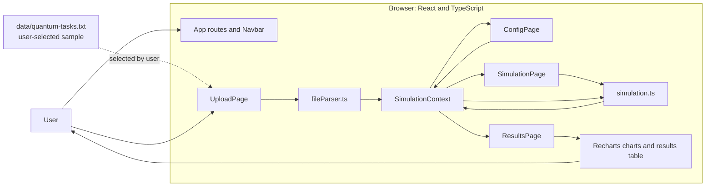
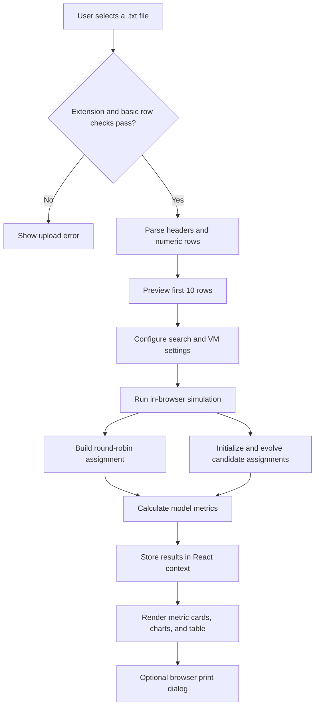

# Quantum Cloud Optimizer

**A browser-based cloud-task scheduling simulator that compares round-robin assignment with a classical, quantum-inspired evolutionary heuristic.**

[](https://react.dev/)
[](https://www.typescriptlang.org/)
[](https://vite.dev/)
[](#license)

Explore the project: [Repository](https://github.com/pudarivyshnavi/Quantum-Cloud-Optimizer) · [Author profile](https://github.com/pudarivyshnavi)

Quantum Cloud Optimizer is an academic demonstration for loading numeric task data, configuring a simulated VM environment, running two task-to-VM assignment strategies, and comparing their modeled metrics. All parsing, simulation, and rendering take place in the web application; the repository does not contain a backend service or connect to quantum hardware or a cloud provider.

## Table of Contents

- [Overview](#overview)
- [Problem Statement and Motivation](#problem-statement-and-motivation)
- [Objectives](#objectives)
- [Core Features](#core-features)
- [Technology Stack](#technology-stack)
- [System Architecture](#system-architecture)
- [Architecture Explanation](#architecture-explanation)
- [Dataset and Input Data](#dataset-and-input-data)
- [Dataset Schema](#dataset-schema)
- [Data Processing and Parsing](#data-processing-and-parsing)
- [Simulation and Optimization Logic](#simulation-and-optimization-logic)
- [Scheduling Factors and Metrics](#scheduling-factors-and-metrics)
- [Optimization Concept and Scope](#optimization-concept-and-scope)
- [System Workflow](#system-workflow)
- [Application Pages and Modules](#application-pages-and-modules)
- [Results and Visualization](#results-and-visualization)
- [Project Structure](#project-structure)
- [Getting Started](#getting-started)
- [Prerequisites](#prerequisites)
- [Installation](#installation)
- [Running the Development Server](#running-the-development-server)
- [Production Build and Preview](#production-build-and-preview)
- [Testing](#testing)
- [Linting](#linting)
- [How the Application Works](#how-the-application-works)
- [Key Capabilities](#key-capabilities)
- [Project Goals](#project-goals)
- [Limitations and Technical Notes](#limitations-and-technical-notes)
- [Future Enhancements](#future-enhancements)
- [Disclaimer](#disclaimer)
- [Author and Connect](#author-and-connect)
- [License](#license)

## Overview

Cloud task scheduling maps computational jobs to available virtual machines (VMs). Different task workloads and VM capacities can produce different execution times and load distributions. This project provides a small, interactive environment for examining that assignment problem with an included workload or a user-uploaded text file.

The current application calculates a round-robin baseline and a QIEA-labeled, quantum-inspired evolutionary search, then presents their model outputs in charts and a comparison table. It is intended for students and evaluators exploring scheduling concepts, not for provisioning or operating production cloud infrastructure.

## Problem Statement and Motivation

Assigning jobs to VMs is a combinatorial problem: the number of possible mappings grows quickly with the number of tasks and machines. A scheduling strategy can affect the modeled makespan, distribution of load, energy estimate, and deadline-based score.

The supplied records include priority, CPU, memory, bandwidth, VM ID, and execution-time columns alongside task length and deadline. However, the current simulation uses task length (or a detected workload column) for assignment metrics and uses a detected deadline only when calculating its scheduling-efficiency metric. It does **not** currently optimize based on task priority, CPU or memory requirements, bandwidth, existing VM IDs, or the supplied `execution_time` field. See [Limitations and Technical Notes](#limitations-and-technical-notes) for the implications.

## Objectives

- Provide a browser interface for uploading and previewing numeric task data.
- Let users configure search parameters and simulated VM count and processing capacity.
- Compare a deterministic round-robin mapping with a randomized quantum-inspired heuristic.
- Calculate and display modeled energy, makespan, utilization, deadline-based efficiency, and estimated cost.
- Make the simulation process and its assumptions inspectable for learning and experimentation.

## Core Features

- **Text workload upload:** Select or drag and drop a `.txt` file; view the detected row count, column names, and first ten records.
- **Configurable simulation:** Adjust population size, generations, mutation rate, crossover probability, rotation angle, VM count, VM MIPS, and the selected energy-model label.
- **Two scheduling outputs:** Compare round-robin assignment with a classical heuristic labeled QIEA.
- **Progress feedback:** Follow simulation stages and generation progress in the browser.
- **Results dashboard:** Review metric cards, interactive Recharts comparisons, a fitness-history line chart, and a metric table.
- **Print/export flow:** Open a printable HTML results summary through the browser's print dialog. The button is labeled “Export Results”; the implementation does not generate a PDF file directly.
- **Responsive navigation:** Move among the Home, Upload, Configure, Results, and About pages. The Simulation page is reached from configuration during the workflow.

## Technology Stack

| Technology | Role in this project |
| --- | --- |
| React 18 | Component-based browser interface and application state |
| TypeScript | Types for pages, parsed workload data, simulation configuration, and results |
| Vite 5 | Development server and production bundler; configured for port `8080` |
| React Router | Client-side page routing |
| Tailwind CSS and project CSS | Styling and responsive layout |
| shadcn/ui-style components with Radix UI | Reusable controls and accessible interaction primitives |
| Recharts | Runtime charts on the results page |
| Framer Motion | Page and component transitions |
| Lucide React | Interface icons |
| Vitest and Testing Library | Unit-test runner and test utilities |
| ESLint | TypeScript/React linting |
| npm | Dependency installation and project scripts |

There is no server-side runtime, database, cloud SDK, or quantum-computing SDK in the implemented application path.

## System Architecture

The application is a client-side React SPA. The included file is a sample for the user to select; it is not automatically loaded by the app. Uploaded text is parsed in the browser, shared through React context, passed to the local simulation module, and then rendered on the results page.



### Text Architecture

```text
User and selected .txt workload
                   |
                   v
UploadPage -> fileParser.ts -> SimulationContext <- ConfigPage
                                                        |
                                                        v
                                          SimulationPage -> simulation.ts
                                                        |             |
                                                        +-- results --+
                                                                  |
                                                                  v
                                       ResultsPage -> Recharts / table
```

## Architecture Explanation

| Component | Responsibility and data flow |
| --- | --- |
| `App.tsx` and `Navbar.tsx` | Register routes and provide navigation around the page components. `SimProvider` wraps the routed pages. |
| `UploadPage.tsx` | Accepts `.txt` uploads through a file chooser or drop zone, calls the parser, and shows a parsed preview. |
| `fileParser.ts` | Converts delimited text into headers and numeric row objects, applying basic row/column-count checks. |
| `SimulationContext.tsx` | Holds the parsed input, configuration, and results in React state while the user moves between pages. This state is in-memory and is not persisted. |
| `ConfigPage.tsx` | Edits the search and VM configuration stored in context. |
| `SimulationPage.tsx` | Starts `runSimulation`, displays progress, stores the returned metrics, and navigates to results. |
| `simulation.ts` | Detects a workload and optional deadline column, produces both assignments, evaluates metrics, and returns fitness history and comparisons. |
| `ResultsPage.tsx` | Reads results from context and renders summary values, charts, a comparison table, and the browser print flow. |

No network request or backend handoff occurs in this pipeline. Uploaded data remains in the current page session's browser memory.

## Dataset and Input Data

The repository includes [`data/quantum-tasks.txt`](data/quantum-tasks.txt), a comma-delimited text file with one header row and **50 task records**. Although the extension is `.txt`, its contents use comma-separated columns. The application does not preload this file: users must choose it on the Upload page to use it as the sample workload.

Example from the actual file:

| task_id | length | priority | deadline | cpu_req | memory_req | bandwidth | vm_id | execution_time |
| ---: | ---: | ---: | ---: | ---: | ---: | ---: | ---: | ---: |
| 1 | 4500 | 5 | 15 | 90 | 4096 | 800 | 1 | 45 |

No units or external benchmark provenance are declared in the file, so the numeric values should be treated as sample simulation inputs rather than standardized real-world measurements.

## Dataset Schema

| Column | Meaning indicated by its name | Current simulation use |
| --- | --- | --- |
| `task_id` | Task identifier | Excluded when inferring a fallback workload column; otherwise not used in the assignment calculation. |
| `length` | Task workload length | **Used** as the primary workload column. |
| `priority` | Task priority | Parsed and previewed, but not used by the scheduler or metrics. |
| `deadline` | Task deadline | **Used only** for the deadline-based efficiency calculation. |
| `cpu_req` | CPU requirement | Parsed and previewed, but not used by the simulation. |
| `memory_req` | Memory requirement | Parsed and previewed, but not used by the simulation. |
| `bandwidth` | Bandwidth requirement | Parsed and previewed, but not used by the simulation. |
| `vm_id` | VM identifier in the input record | Parsed and previewed; the simulation generates its own task-to-VM mappings instead. |
| `execution_time` | Execution-time value in the input record | Parsed and previewed, but not used by the simulation's makespan calculation. |

## Data Processing and Parsing

`UploadPage` reads the selected file with the browser `FileReader` API and accepts files whose names end in `.txt`. `parseFile` then:

1. Trims and removes empty lines.
2. Detects a tab delimiter when the header contains tabs and at least as many tabs as commas; otherwise it detects commas, falling back to whitespace splitting.
3. Uses the first non-empty line as column headers and parses remaining cells with `parseFloat`.
4. Converts non-numeric cell values to `0`; rows with too few columns are skipped.
5. Requires at least one header plus five data rows, and at least two columns.

The parser is intentionally simple: it does not implement full quoted-CSV escaping, schema-specific validation, units, or checks for missing columns required by a particular analysis. The simulation has some workload-column name detection and fallback logic, described below.

## Simulation and Optimization Logic

Both approaches process the same parsed rows and configured VM count/MIPS.

### Round-Robin Baseline

The baseline maps row index `i` to VM `i % numVMs`. This is a round-robin allocation, **not FCFS**, despite the Simulation page's progress text referring to “Traditional Scheduling (FCFS).” The allocation does not sort tasks by priority, length, or deadline.

### QIEA-Labeled Heuristic

The implementation in `src/lib/simulation.ts` uses classical JavaScript calculations:

1. Create `populationSize` candidate individuals, each with one `[alpha, beta]` pair per task. Each pair begins as `[cos(angle), sin(angle)]` for a random angle in `[0, π/2)`, so its components have unit magnitude.
2. Convert each pair's angle into a VM index to observe a candidate task-to-VM assignment.
3. Evaluate the assignment and calculate fitness.
4. Rotate each candidate's pairs by the configured angle in the forward direction when its fitness improves the global best, or in reverse otherwise.
5. With the configured mutation probability, replace one randomly selected task's pair with a new random angle.
6. Record the global best fitness for each generation and evaluate the best assignment at the end.

If the search produces no usable best assignment, a fallback sorts tasks by workload descending and assigns each to the currently least-loaded VM. The search uses `Math.random()` and does not set a seed, so repeated runs are not guaranteed to be reproducible.

The UI exposes a crossover probability, but `crossoverProb` is not read by the simulation algorithm and no crossover operation is implemented. The configuration control currently has no effect on results.

## Scheduling Factors and Metrics

### Workload and Deadline Detection

The simulation looks for workload headers such as `length`, `mi`, `workload`, `size`, `cloudlet_length`, or `task_length`, case-insensitively. If none is found, it chooses the non-ID column with the highest average numeric value; as a final fallback it uses the second header. A deadline is detected from `deadline`, `due`, or `max_time`. Missing workload values fall back to `1`; missing or zero deadline values are treated as no deadline.

### Configuration

| Parameter | Default | Used by the simulation? |
| --- | ---: | --- |
| Population size | 50 | Yes; number of candidate individuals |
| Generations | 100 | Yes; number of search iterations |
| Mutation rate | 0.05 | Yes; chance to mutate one task in an individual |
| Crossover probability | 0.8 | No; control exists in UI/state but has no algorithm implementation |
| Rotation angle | 0.05 | Yes; amplitude-pair update angle |
| Number of VMs | 10 | Yes |
| VM processing power | 1000 MIPS | Yes; converts assigned workload to modeled time |
| Energy model | Linear | Yes; selects a power factor and imbalance penalty formula |

### Metric Calculations

Let $L_v$ be the sum of task workloads assigned to VM $v$, $M$ the configured MIPS per VM, and $T_v = L_v / M$. The implementation reports:

- **Makespan / execution time:** $\max_v T_v$.
- **Utilization / balance score:** $100 \times \frac{1}{N}\sum_v (T_v / \max_j T_j)$, where $N$ is the VM count. This is the implementation's normalized balance formula, not a measurement of physical CPU utilization.
- **Energy estimate:** For each VM, base energy is $(L_v/M) \times p$, multiplied by an imbalance penalty. The power factor $p$ is `0.10` for Linear, `0.12` for Square, and `0.15` for Cubic. The penalty uses `1 + 0.5d` for Linear, `1 + 0.8d` for Square, and `1 + d²` for Cubic, where $d = |L_v - \bar{L}| / \bar{L}$ and $\bar{L}$ is average VM load.
- **Scheduling efficiency:** Percentage of tasks whose cumulative workload divided by VM MIPS is within that task's detected deadline (or has no deadline). Tasks are checked in their input-row order, separately for each VM; this is a simplified estimate, not a full event-based execution simulation.
- **Estimated cost:** `totalEnergy * 0.12 + numVMs * makespan * 0.065`. The dollar sign shown by the interface is a presentation label; this formula is not tied to any provider's rates.

The comparison's **fitness** uses energy, makespan, and the inverse of the utilization score:

```text
fitness = 1 / (0.4 * energy + 0.4 * makespan
                     + 0.2 * (1 - utilization / 100) + 0.0001)
```

The formula combines raw modeled energy and time with a normalized utilization term. Scheduling efficiency and estimated cost are reported but do not contribute to fitness. The returned “improvement” values are arithmetic comparisons of the two model outputs; they are not measured performance gains.

## Optimization Concept and Scope

**Implemented:** A classical, randomized heuristic uses amplitude-pair representation and rotation-inspired updates, then compares its selected assignment with round-robin.

**Quantum-inspired concept:** The pair representation and rotation terminology borrow ideas associated with quantum-inspired evolutionary methods. This project does not simulate a quantum processor, build quantum circuits, call QAOA, or execute on quantum hardware.

**Not implemented:** Resource-capacity constraints for CPU, memory, or bandwidth; priority-aware scheduling; crossover; real VM execution; cloud-provider integration; reproducible random seeding; and a validated multi-objective optimizer. These are not implied by the project title or the input columns.

## System Workflow



1. Start on Home and open Upload.
2. Choose a `.txt` workload. To try the bundled sample, select `data/quantum-tasks.txt` from the repository after starting the application.
3. Review the parser's row and column counts and the first ten rows, then continue to Configure.
4. Adjust algorithm and VM settings. Note that the crossover slider is currently inactive in the simulation.
5. Run the simulation. The app calculates both assignments locally and updates progress.
6. Review results and optionally open the browser's print dialog for the summary.

## Application Pages and Modules

| Page or module | Purpose |
| --- | --- |
| Home (`/`) | Project introduction and link into workload upload. |
| Upload (`/upload`) | `.txt` selection/drop, basic parse validation, column badges, task/parameter counts, and up-to-10-row preview. |
| Configure (`/configure`) | Search parameters, VM count/MIPS, and energy-model selection. Redirects users without uploaded data back to Upload. |
| Simulation (`/simulation`) | Starts the computation, displays staged and generation progress, and navigates to Results after completion. |
| Results (`/results`) | Displays the metric comparisons and charts, and offers “Run Again” and print-oriented export. |
| About (`/about`) | In-app explanatory content about cloud scheduling and QIEA concepts. |
| Not Found (`*`) | Fallback for unknown client-side routes. |

Shared simulation types and state live in `src/lib/simulation.ts` and `src/context/SimulationContext.tsx`; parsing is in `src/lib/fileParser.ts`.

## Results and Visualization

The Results page creates interactive charts from the current in-memory simulation output using Recharts:

- **Energy consumption comparison:** Bar chart for round-robin and QIEA-labeled energy estimates.
- **Fitness by generation:** Line chart of the best recorded fitness.
- **Execution time comparison:** Bar chart of modeled makespan.
- **Resource utilization comparison:** Bar chart of the normalized load-balance score.
- **Estimated cost comparison:** Bar chart using the project's cost formula.
- **Metric table:** Shows energy, execution time, utilization, scheduling efficiency, estimated cost, and the reported difference for each.

There are no committed application screenshots or generated visualization images in the repository. These charts are rendered by the running application, not static image assets. No benchmark results are included in the repository, so this README makes no claim that one scheduler consistently outperforms another.

## Project Structure

```text
quantum-cloud-optimizer/
├── data/
│   └── quantum-tasks.txt          # 50-row comma-delimited sample workload
├── public/
│   ├── favicon.ico                # Browser favicon
│   ├── placeholder.svg            # Existing generic placeholder asset
│   └── robots.txt                 # Crawler instructions
├── src/
│   ├── components/
│   │   ├── ui/                    # Reusable UI primitives (Radix/shadcn-style)
│   │   ├── Navbar.tsx             # Main route navigation
│   │   └── NavLink.tsx             # Navigation link helper
│   ├── context/
│   │   └── SimulationContext.tsx  # In-memory workload/config/results state
│   ├── hooks/
│   │   ├── use-mobile.tsx         # Responsive viewport helper
│   │   └── use-toast.ts           # Toast hook
│   ├── lib/
│   │   ├── fileParser.ts          # Delimited text parsing
│   │   ├── simulation.ts          # Assignment strategies and metric calculations
│   │   └── utils.ts                # Shared utility functions
│   ├── pages/
│   │   ├── AboutPage.tsx          # QIEA and project explanation
│   │   ├── ConfigPage.tsx         # Simulation configuration
│   │   ├── Home.tsx               # Landing/entry page
│   │   ├── Index.tsx              # Existing fallback page component
│   │   ├── NotFound.tsx           # Unknown-route page
│   │   ├── ResultsPage.tsx        # Metrics and charts
│   │   ├── SimulationPage.tsx     # Progress and simulation trigger
│   │   └── UploadPage.tsx         # File input and preview
│   ├── test/
│   │   ├── example.test.ts        # Current Vitest example test
│   │   └── setup.ts               # Test environment setup
│   ├── App.tsx                    # Providers and route table
│   ├── App.css                    # App-level stylesheet
│   ├── index.css                  # Tailwind directives and theme styles
│   ├── main.tsx                   # React entry point
│   └── vite-env.d.ts              # Vite client types
├── .gitignore
├── bun.lock                       # Bun dependency lockfile
├── bun.lockb                      # Binary Bun lockfile
├── components.json                # UI generator configuration
├── eslint.config.js               # ESLint configuration
├── index.html                     # Vite HTML entry
├── package.json                   # Dependencies and npm scripts
├── package-lock.json              # npm dependency lockfile
├── playwright-fixture.ts          # Playwright fixture setup
├── playwright.config.ts           # Playwright configuration
├── postcss.config.js              # PostCSS configuration
├── tailwind.config.ts             # Tailwind theme/configuration
├── tsconfig.json                  # TypeScript project references
├── tsconfig.app.json              # Application TypeScript options
├── tsconfig.node.json             # Tooling TypeScript options
├── vite.config.ts                 # Vite config and port 8080
├── vitest.config.ts               # Vitest config
└── README.md
```

The `src/components/ui/` directory contains the project's UI primitives; its individual component files are omitted from the tree to keep the overview readable. Generated directories such as `node_modules/` and `dist/` are not part of the source tree.

## Getting Started

### Prerequisites

- Windows, macOS, or Linux
- Node.js with npm (use a current Node.js LTS release)
- Git, if cloning from GitHub
- A modern web browser

The project has no environment-variable, credentials, database, or cloud-account setup requirements.

### Installation

In Windows PowerShell, clone the repository and install its dependencies:

```powershell
git clone https://github.com/pudarivyshnavi/Quantum-Cloud-Optimizer.git
Set-Location Quantum-Cloud-Optimizer
npm install
```

If you already have the repository locally, open a terminal at the project root containing `package.json` and run `npm install`.

### Running the Development Server

```powershell
npm run dev
```

Vite is configured for port `8080`. Open [http://localhost:8080](http://localhost:8080). If Vite reports a different URL because the configured port is unavailable, use the URL printed in the terminal.

### Production Build and Preview

Create a production bundle:

```powershell
npm run build
```

For a development-mode build, use `npm run build:dev`. To serve the production bundle locally for review:

```powershell
npm run preview
```

## Testing

Run the configured Vitest suite once:

```powershell
npm run test
```

Run Vitest in watch mode:

```powershell
npm run test:watch
```

The repository currently includes a minimal example assertion in `src/test/example.test.ts`. The presence of a passing example test should not be interpreted as comprehensive verification of parsing, scheduling, or UI behavior. Playwright config/fixture files are present, but no npm script is defined for running them.

## Linting

Run ESLint across the project with:

```powershell
npm run lint
```

## How the Application Works

The page workflow is backed by `SimulationContext`, which retains the parsed workload, configuration, and results while navigating within the current SPA session. Upload invokes parsing; Configure changes the stored values; Simulation calls `runSimulation`; Results reads the returned metrics and renders them. Refreshing the page clears this context state because no persistence layer is implemented.

For each strategy, workload is accumulated per VM and converted to simulated time using the configured MIPS. The results page compares both metric objects and plots selected values. The sample file's task IDs and VM IDs do not control those generated assignments.

## Key Capabilities

- Local text-file parsing and preview in the browser.
- Adjustable VM and heuristic parameters.
- Side-by-side round-robin and QIEA-labeled heuristic metrics.
- Generation fitness history and interactive comparison charts.
- A print-dialog-based results summary.

## Project Goals

The project aims to make task-to-VM scheduling ideas approachable through an interactive visual demonstration. Its current value is as a learning and prototyping tool: users can inspect how a simple workload model and assignment heuristic produce comparative values, while seeing the assumptions that shape those values.

## Limitations and Technical Notes

- This is a frontend-only simulation, not a production scheduler. It does not create VMs, execute jobs, monitor infrastructure, or call a cloud API.
- “Quantum-inspired” describes classical code using a pair-and-rotation heuristic. There is no quantum hardware, circuit, QAOA, or other quantum backend.
- Only the detected workload value and optional deadline feed the calculations. Priority, CPU, memory, bandwidth, input VM ID, and input execution time are not scheduling constraints or metric inputs.
- The baseline is round-robin. A UI progress label says FCFS, but the code's mapping is round-robin.
- The crossover slider is present but crossover is not implemented or used.
- Random choices use `Math.random()` without a seed, so a run is not guaranteed to reproduce identical results.
- Energy, utilization, efficiency, and cost are simplified model outputs. They are not calibrated power measurements, cloud bills, or a full discrete-event execution simulation.
- A single example test exists; comprehensive unit, integration, and browser coverage is not included in the npm scripts.
- There are no committed screenshots, benchmark reports, or evidence for generalized performance improvements.

## Future Enhancements

Potential future work, not current functionality:

- Add unit-aware schema validation and formal workload/VM capacity constraints.
- Incorporate priority, CPU, memory, bandwidth, VM availability, and execution-time data into the scheduling model.
- Implement and test crossover, or remove the inactive control; document and validate the heuristic against known cases.
- Add seedable randomness and repeatable experiment configurations.
- Compare additional baseline schedulers and established optimization methods with transparent objective functions.
- Improve energy, utilization, deadline, and cost models and document their units and assumptions.
- Add workload-scale experiments, statistical comparisons, and exportable structured reports.
- Consider backend or cloud-provider integrations only as a separate production-oriented extension with appropriate security and infrastructure design.
- Explore genuine quantum optimization frameworks as research work, clearly separate from the current classical heuristic.

## Disclaimer

This application is an educational simulation. Its outputs depend on the uploaded numeric data, algorithm settings, and simplified formulas described above. They should not be used as operational cloud-allocation decisions, billing estimates, or claims of measured energy or performance savings.

## Author and Connect

**Author:** Pudari Vyshnavi

**GitHub:** [pudarivyshnavi](https://github.com/pudarivyshnavi)

**Repository:** [Quantum-Cloud-Optimizer](https://github.com/pudarivyshnavi/Quantum-Cloud-Optimizer)

## License

No `LICENSE` file is present in the repository. No open-source license is stated here; consult the repository owner before reuse or redistribution.